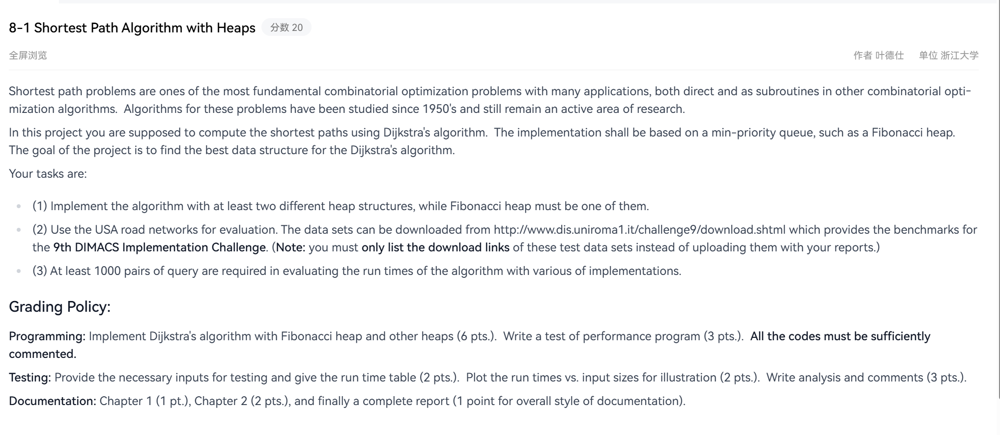
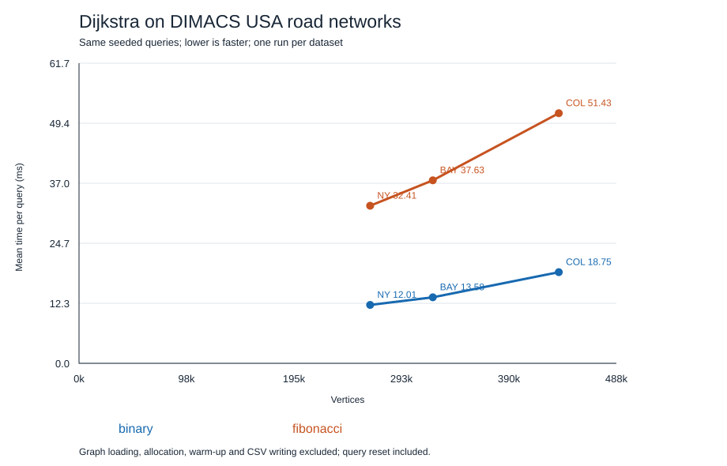

# 题目描述：



# 题目分析
最短路径问题是最基本的组合优化问题之一，具有许多应用，既可以直接应用，也可以作为其他组合优化算法中的子程序。自20世纪50年代以来，人们一直在研究这些问题的算法，并且至今仍是一个活跃的研究领域。

在本项目中，应当使用Dijkstra算法来计算最短路径。实现应基于最小优先队列，例如Fibonacci堆。本项目的目标是找到适合Dijkstra算法的最佳数据结构。

任务是：

（1）用至少两种不同的堆结构实现该算法，其中Fibonacci堆必须是其中之一。
（2）使用USA道路网络进行评测。数据集可从 http://www.dis.uniroma1.it/challenge9/download.shtml 下载，该网站提供了第9届DIMACS实现挑战赛的基准数据。（注意：你只能列出这些测试数据集的下载链接，而不要将它们随报告一起上传。）
（3）在评测各种实现算法的运行时间时，至少需要使用1000对查询。

# 评分
编程：用Fibonacci堆和其他堆实现Dijkstra算法（6分）。编写性能测试程序（3分）。所有代码必须有充分的注释。

测试：提供必要的测试输入并给出运行时间表（2分）。绘制运行时间与输入规模的关系图以进行说明（2分）。撰写分析和评论（3分）。

文档：第1章（1分）、第2章（2分），最后是一份完整的报告（文档整体风格1分）。

# 评分细则与报告章节映射

本题评分由题面给出（见上文「评分」），其条目与报告章节、代码的对应关系如下（根 `readme.md` 第 3.2 节要求）：

| 评分条目 | 分值 | 落点 |
| --- | --- | --- |
| 文档 第 1 章 | 1 | `documentation/report.md` Chapter 1 |
| 文档 第 2 章 | 2 | Chapter 2（CSR 图、Dijkstra、二叉堆、Fibonacci 堆的伪代码与数据结构） |
| 编程：Fibonacci 堆与另一堆实现 Dijkstra | 6 | `code/`（`dijkstra.c`、`binary_heap.c`、`fibonacci_heap.c`、`graph.c`），见 `code/README.md` |
| 编程：性能测试程序 | 3 | `code/benchmark.c`、`code/plot_results.py` |
| 测试：测试输入与运行时间表 | 2 | Chapter 3 + `testresult/validation-20261013.zip` |
| 测试：运行时间与输入规模关系图 | 2 | Chapter 3 + `documentation/runtime.svg` |
| 测试：分析与评论 | 3 | Chapter 4 |
| 文档整体风格 | 1 | 全文 |

# 实现状态与目录

已完成 C99 的二叉堆及 Fibonacci 堆 Dijkstra、DIMACS 文件读取、路径输出和性能评测程序。2026-10-13 已完成三份真实 USA 路网各 1000 对查询的实测及独立正确性测试。代码与报告待组内评审；当前报告为 Markdown，尚未定稿转 PDF。

```text
pr2/
├── readme.md
├── image.png                  # 保留原题面截图
├── code/
│   ├── README.md              # 接口、变量和功能清单
│   ├── graph.c/.h             # DIMACS 读取与 CSR 图
│   ├── binary_heap.c/.h       # 带位置映射的二叉堆
│   ├── fibonacci_heap.c/.h    # 句柄、合并与级联切割
│   ├── dijkstra.c/.h          # 共用最短路径流程
│   ├── main.c                # 单次查询与路径输出
│   ├── benchmark.c           # 同查询计时与距离核对
│   ├── plot_results.py        # CSV 转 SVG 曲线，无第三方依赖
│   ├── Makefile
│   └── tests/                # C 独立对拍与 Python 回归入口
├── documentation/
│   ├── README.md
│   ├── report.md             # Chapter 1—4
│   └── runtime.svg           # 三路网实测曲线
└── testresult/
    └── validation-20261013.zip # 测试代码、合成输入、日志和结果
```

# 代码设计

1. **图存储**：使用 CSR 邻接表，顶点的出弧位于 `offset[u]..offset[u+1]`；保留有向弧、重边、自环和零权边。文件顶点编号从 1 开始，内存从 0 开始。
2. **二叉堆**：`items` 保存顶点，`position` 保存顶点到堆下标的映射，插入和 decrease-key 上浮，extract-min 下沉；每个顶点最多存在一个堆条目。
3. **Fibonacci 堆**：顶点编号作为稳定句柄；数组节点保存父亲、孩子、左右兄弟、度数和标记。根及孩子组成双向循环链表；删除最小值后按度数合并，降低键值时执行切割及级联切割。
4. **共用 Dijkstra**：维护 `distance`、`previous` 和 `settled`，仅将首次发现的顶点入堆，改进已有候选时减小键值。目标出堆后才提前终止。两种堆按“距离、顶点编号”相同顺序打破平局。
5. **距离安全**：使用 `uint64_t`，`UINT64_MAX` 表示不可达；负权、非法编号、弧数不符、非法记录和整数溢出均报错。为确保简单路径距离可表示，弧权上限为 `(UINT64_MAX-1)/max(n-1,1)`，超过该限制的输入会被保守拒绝。
6. **性能比较**：工作区提前分配并复用；两种堆使用同一随机查询序列，固定种子、交替执行顺序；逐对核对距离，计时包含查询状态重置，不包含图读取、初次内存分配、预热与 CSV 写入。

更多接口说明见 [code/README.md](code/README.md)，伪代码与复杂度见 [报告 Chapter 2、4](documentation/report.md)。

# 编译与运行

需要 GCC；Python 3 仅用于自动回归和绘图，核心算法没有第三方依赖。以下命令在 `pr2/code/` 执行：

```sh
gcc -std=c99 -O2 -Wall -Wextra -Wpedantic main.c graph.c binary_heap.c fibonacci_heap.c dijkstra.c -o shortest_path
gcc -std=c99 -O2 -Wall -Wextra -Wpedantic benchmark.c graph.c binary_heap.c fibonacci_heap.c dijkstra.c -o benchmark
gcc -std=c99 -O2 -Wall -Wextra -Wpedantic -I. tests/test.c graph.c binary_heap.c fibonacci_heap.c dijkstra.c -o test_runner

./test_runner
./shortest_path /path/to/USA-road-d.NY.gr binary 1 100
./shortest_path /path/to/USA-road-d.NY.gr fibonacci 1 100
./benchmark /path/to/USA-road-d.NY.gr 1000 20261013 NY.csv
```

Linux 也可执行 `make` 和 `make test`；Windows PowerShell 使用 `.\shortest_path.exe`、`.\benchmark.exe`、`.\test_runner.exe` 替换上述可执行文件调用。MinGW GCC 可直接编译；本次实测为 Windows，未声称已在 Linux 上实测。

完整回归：

```sh
python tests/run_tests.py --output /path/to/local-validation
```

三路网评测与绘图：

```sh
./benchmark /path/to/USA-road-d.NY.gr 1000 20261013 NY.csv
./benchmark /path/to/USA-road-d.BAY.gr 1000 20261013 BAY.csv
./benchmark /path/to/USA-road-d.COL.gr 1000 20261013 COL.csv
python plot_results.py NY.csv BAY.csv COL.csv --output runtime.svg
```

输出 CSV 包含图规模、查询数、种子、堆类型、累计秒数、平均毫秒数、可达查询数、距离摘要、出堆及松弛统计、计时分辨率。相同图及种子可复现查询和距离摘要，运行时间允许变化。查询允许重复，但每对起终点不同；不可达查询也参与计时。查询数少于 1000、种子为 0 或图少于两个顶点会被拒绝。

# 数据下载

使用第九届 DIMACS 挑战赛的距离权重版本；解压 `.gr.gz` 后将 `.gr` 路径传给程序。程序不直接读取 gzip，也不自动联网。

- [题面数据页面](http://www.dis.uniroma1.it/challenge9/download.shtml)
- [NY：纽约](https://www.diag.uniroma1.it/challenge9/data/USA-road-d/USA-road-d.NY.gr.gz)
- [BAY：旧金山湾区](https://www.diag.uniroma1.it/challenge9/data/USA-road-d/USA-road-d.BAY.gr.gz)
- [COL：科罗拉多](https://www.diag.uniroma1.it/challenge9/data/USA-road-d/USA-road-d.COL.gr.gz)

这些原始道路数据不包含在报告、测试压缩包或交付包中。

# 实测摘要

环境：Windows x64，AMD Ryzen 9 8940HX，MinGW-w64 GCC 15.2.0；编译参数为 `-std=c99 -O2 -Wall -Wextra -Wpedantic`（回归构建另外启用 `-Werror`）。日期为 2026-10-13。

| 路网 | 顶点 | 有向弧 | 查询数 | 二叉堆总时间（秒） | Fibonacci 堆总时间（秒） |
| --- | ---: | ---: | ---: | ---: | ---: |
| NY | 264346 | 733846 | 1000 | 12.010 | 32.405 |
| BAY | 321270 | 800172 | 1000 | 13.579 | 37.635 |
| COL | 435666 | 1057066 | 1000 | 18.747 | 51.433 |

全部 3000 对查询距离一致。独立测试通过 30000 次堆操作审计，以及 100 张小图上的 137400 次距离和路径检查；另有输入校验、CLI 和固定种子重复运行测试。



本轮结果中二叉堆更快；这是本机、三个数据集、单轮实验的结果，不能推断所有图和所有实现。计时使用 C `clock()`；本机时钟每秒 1000 tick。不同 C 运行库的 `clock()` 语义可能不同（CPU 时间或经过时间），跨平台结果应单独比较。详细统计、限制及分析见报告。

# 待评审事项

根 `readme.md` 第 3.2 节原先把 pr1 的倒排索引与查询阈值当作全仓库通用的报告要求。管理员已按 `readme-feedback-believeSong55-20261013.md` 的意见改写该节：拆分为「通用要求 + pr1 专属细则」两层，并新增「每个 prN 在本项目 readme 中给出评分细则条目与报告章节映射表」的要求（本项目映射见上文「评分细则与报告章节映射」）。

本次经确认将 pr2 报告按最短路径题目组织，保留四章结构；项目索引仅追加 pr2 一行。代码与报告仍待管理员 nothing793 评审，报告尚未生成定稿 PDF。
