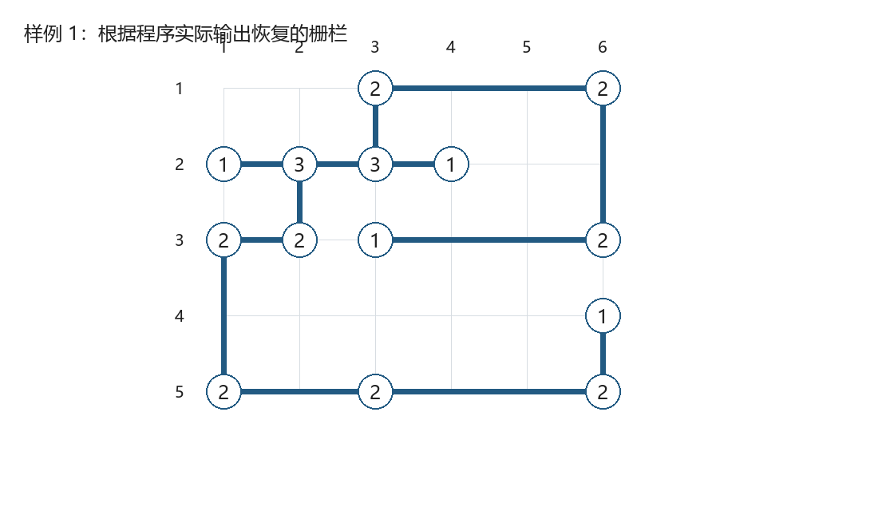
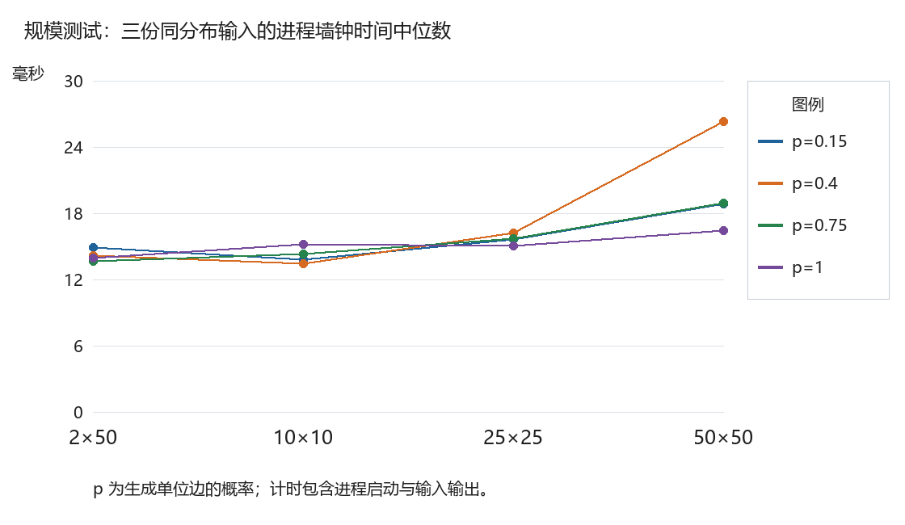

# Project 3：栅栏布局恢复

作者：陈昱年，宋诗雨，王宇轩
第四组。
陈昊老师。

完成日期：2026 年 10 月 20 日

采用候选图建模与冲突驱动的布尔约束求解，恢复满足度数和几何限制的任意一组栅栏布局。程序以 C99 实现，报告依据逐例测试记录编写。

## Chapter 1 问题描述

### 1.1 任务与输入输出

花园是 n 行 m 列的网格，$2\le n,m\le 50$。非零格点放置度数为 1 至 4 的连接器，零格点表示没有连接器。栅栏必须水平或竖直，不能自行转弯，也不能在没有连接器的位置相交。本项目根据连接器位置和度数恢复布局；无法满足约束时输出 `No Solution`。

每个连接器需要输出所在行、列及上、下、左、右四个方向的 0/1 状态，采用从 1 开始的行列编号，按行优先排序。多解时输出任意合法布局，不要求与样例逐字相同。题目没有要求所有连接器构成一个连通分量，也没有最小化总长度的目标。

### 1.2 问题中的两类约束

度数约束只规定连接器使用多少个方向，不能单独保证几何合法。例如 3×3 花园四条边中点各有一个一度连接器、中心为空时，水平和竖直两条线都被迫选取，虽然端点度数均满足，却在中心交叉，因此仍应判为无解。

程序将“恰好满足度数”与“空位置不交叉”分别编码。连接器处允许多个方向相接，包括四路交汇。没有连接器的花园对应空布局，标准输出为空；输入格式错误与合法输入无解分开处理，前者写入标准错误并以非零状态退出。

## Chapter 2 数据结构与算法

### 2.1 候选边的完备构造

沿每一行和每一列扫描，仅连接相邻的非零格点，得到候选图 $G=(V,E)$。若一条直线经过另一个连接器，它可以在该连接器处分成两条候选边；因此无需添加跨越中间连接器的跳跃边。每个连接器至多关联四条候选边。

令 $x_e\in\{0,1\}$ 表示候选边 $e\in E$ 是否被选取。内部文字编码采用 `2*e` 表示 $x_e$，`2*e+1` 表示 $\neg x_e$。端点、端口方向和经过的空格在建模阶段确定。记顶点 $v$ 的关联边集合为 $\delta(v)$，可用方向数为 $d_v=|\delta(v)|$，目标度数为 $k_v$。

| 数据结构 | 内容及用途 |
| --- | --- |
| Garden | 行列数及每个格点要求的度数 |
| Model.edges | 候选边的两个端点和正向端口 |
| Model.incident | 每个连接器四个方向对应的边编号，无边为 -1 |
| horizontal / vertical | 各空格经过的水平、竖直候选边，用于发现交叉 |
| Clause / watches | 子句文字数组及按文字编号组织的双监视表 |
| values / levels / reasons | 当前真值、决策层及推导原因子句 |
| trail / limits | 赋值轨迹及各决策层起点，支持撤销赋值 |
| activity / heap | 变量活动度与最大堆，只改变搜索顺序 |

### 2.2 度数、交叉与必要条件

每个连接器恰好选择 $k_v$ 条关联边，即

$$
\sum_{e\in\delta(v)}x_e=k_v,\qquad v\in V.
$$

当 $k_v>d_v$ 时加入空子句。否则，先对任意 $k_v+1$ 条关联边规定“不能全真”，得到至多 $k_v$ 条的条件：

$$
\bigwedge_{\substack{A\subseteq\delta(v)\\|A|=k_v+1}}
\left(\bigvee_{e\in A}\neg x_e\right).
$$

再对任意 $d_v-k_v+1$ 条关联边规定“不能全假”，得到至少 $k_v$ 条的条件：

$$
\bigwedge_{\substack{B\subseteq\delta(v)\\|B|=d_v-k_v+1}}
\left(\bigvee_{e\in B}x_e\right).
$$

两组条件合起来等价于精确度数约束。由于 $d_v\le4$，至多枚举 $2^{d_v}\le16$ 个子集，每个连接器最多产生 8 个子句。

若空格同时经过水平候选边 $e_h$ 与竖直候选边 $e_v$，则要求

$$
x_{e_h}+x_{e_v}\le1
\quad\Longleftrightarrow\quad
\neg x_{e_h}\lor\neg x_{e_v}.
$$

同一空格每个轴至多存在一条候选边，因此扫描空格即可发现全部交叉。

此外，每个候选图连通分量 $C$ 都必须满足

$$
\sum_{v\in C}k_v\equiv0\pmod2.
$$

若分量能够二染色，记其两侧为 $A_C$、$B_C$，每条选中边对两侧各贡献 1，故还必须满足

$$
\sum_{v\in A_C}k_v=\sum_{v\in B_C}k_v.
$$

这些必要条件只用于提前判定矛盾，并未假定候选图总是二分图。测试中的五连接器矩形布局，在一条边上插入一个连接器后便形成可解的奇环。

### 2.3 建模伪代码

以下采用 Python 风格伪代码表示集合和循环，实际评测程序由 C99 实现。

```python
def build_formula(garden):
    edges = scan_consecutive_connectors(garden)
    solver = create_solver(len(edges))
    for component in candidate_components(edges):
        add_component_checks(solver, component)
    for vertex in connectors(garden):
        S, k = incident_edges(vertex), degree(vertex)
        if k > len(S):
            add_clause(solver, [])  # 空子句表示矛盾
        else:
            for A in subsets(S, size=k + 1):
                add_clause(solver, [NOT(e) for e in A])
            for B in subsets(S, size=len(S) - k + 1):
                add_clause(solver, [e for e in B])
    for h, v in empty_cell_crossings(edges):
        add_clause(solver, [NOT(h), NOT(v)])
    return solver
```

### 2.4 约束求解

求解器使用冲突驱动子句学习（CDCL）。赋值后只检查刚刚变假的文字所在监视表。若子句能找到另一个非假的文字，就迁移监视；否则剩余监视文字必须被推导为真，或形成冲突。单位条件保存在赋值队列中，空子句立即表示矛盾。

冲突发生后，沿赋值轨迹反向分析原因子句，并消解到学习子句中只剩一个当前层文字，即 First UIP。回跳到学习子句其他文字的最高层后，新的子句会立刻推导一个赋值。变量活动度增加，使近期冲突涉及的变量优先被选择；堆的比较规则相同时优先较小编号，保证运行可复现。

重启在冲突预算达到阈值后执行，保留学习子句和已保存的分支相位。初始预算为 100，此后按 1.5 倍增长，达到上限附近后停止增长。当前版本不清理学习子句。所有内存分配均检查失败；运行资源错误不能被当作无解。

```python
def solve(formula):
    enqueue_original_units(level=0)
    while True:
        conflict = propagate()
        if conflict is not None:
            if current_level() == 0:
                return UNSAT
            learned = first_uip(conflict)
            target = highest_other_level(learned)
            cancel_until(target)
            store_clause(learned)
            enqueue(learned[0], reason=learned)
        else:
            if restart_budget_reached():
                cancel_until(0)
            if all_variables_assigned():
                return SAT
            variable = choose_by_activity()
            begin_level()
            enqueue(saved_phase(variable), reason=None)
```

实际 C 实现中，冲突分析与回跳后的关键语句如下（为便于阅读，调整了空白和分行）。学习子句保存后立即推导其断言文字；相关数组和不变量的中文注释见 `code/sat.c`。

```c
int backtrack, id;

backtrack = analyze(s, conflict);
cancel_until(s, backtrack);
id = store_clause(s, s->learned.data, s->learned.count);
++s->stats.learned;

if (!enqueue(s, s->learned.data[0], id)) {
    return 0;
}
```

### 2.5 正确性说明

必要性：任意合法栅栏都可分解为同一行或列相邻连接器之间的边，故对应候选边的一个赋值。每个连接器恰好使用 $k_v$ 个方向，满足基数子句；没有空位置交叉，满足所有交叉互斥子句。分量必要条件由边对端点度数的贡献直接得到，不会排除合法布局。

充分性：任意满足公式的赋值都在每个连接器上选出恰好 $k_v$ 条边。候选边是端点之间没有其他连接器的直线，故没有悬空终点或无连接器转弯。互斥子句排除了所有内部空格上的水平、竖直交叉。将每条选中边同时写入两个端点的相反方向，便得到合法且互反一致的输出。

搜索层面，单位传播只采用子句的逻辑蕴含，学习子句由冲突原因消解产生，不改变原公式的满足模型。回溯撤销赋值而不撤销约束；第 0 层出现矛盾时可判无解。双监视机制保证不会在存在全假子句时返回完整模型。算法思想参考文献 [1]，C 程序未调用外部 SAT 库。

## Chapter 3 测试与结果

### 3.1 环境和验证方法

测试日期为 2026 年 10 月 20 日。平台：Windows-11-10.0.26200-SP0；Python：3.12.14；编译器：gcc (MinGW-W64 x86_64-ucrt-posix-seh, built by Brecht Sanders, r6) 15.2.0。编译选项为 `-std=c99 -O2 -Wall -Wextra -Wpedantic`，主程序与 SAT 测试入口均零告警编译。固定随机种子为 20261020。

验证分为两层。花园层的小规模参考程序通过两两枚举连接器及直接选边搜索判断可行性，不使用 C 程序的子句编码。对于可解输出，再沿四个方向追踪真实端点，检查行序、字段格式、0/1 状态、度数、端点互反和空格交叉；这允许程序返回不同于样例的合法解。

对于 50×50 等大规模可解用例，先在完整网格上随机选择单位边，再从已知合法布局反推度数。零度连接器删除后，原选中边仍构成合法见证，因此可以独立确定输入可解。统计中每个概率使用三份不同的同分布输入，计时采用这三份输入的进程墙钟中位数，包含进程启动、读入、求解和输出。

### 3.2 完整测试分组

| 测试组 | 数量 | 可解 | 无解 | 结论 |
| --- | --- | --- | --- | --- |
| 题目样例 | 3 | 2 | 1 | 全部通过 |
| 专项边界 | 12 | 8 | 4 | 全部通过 |
| 2×2 全部度数组合 | 625 | 15 | 610 | 全部通过 |
| 3×3 全部 0/1 组合 | 512 | 181 | 331 | 全部通过 |
| 随机小规模对拍 | 600 | 23 | 577 | 全部通过 |
| 已知布局反推的大规模输入 | 48 | 48 | 0 | 全部通过 |
| 满网格二度连接器 | 3 | 2 | 1 | 全部通过 |
| 大规模不可行分量 | 1 | 0 | 1 | 全部通过 |


上述 1804 个花园用例全部通过，另有 14 个非法输入检查和 2 个接口错误路径检查通过。非法输入包括行列数越界、缺失数据、非法度数、负数、整数溢出和多余 token；要求返回 1、标准输出为空，并给出明确的输入错误。未知参数必须返回 1；标准输出连接到只读句柄时，显式刷新须发现写入失败并返回 2。

逐例完整数据表为压缩包内的 `cases.csv`，每行包含用例编号、测试目的、尺寸、预期、实际、是否通过、墙钟时间及搜索统计。每个合法输入另附输入文件、原始输出和退出码；非法输入记录在 `logs/invalid_*.json`。下表列出题目样例和几何、图论边界用例，其余穷举及随机用例逐行保存在 CSV 中。

| 用例 | 目的 | 预期 | 实测 |
| --- | --- | --- | --- |
| sample_1 | 题目样例及非唯一解几何检查 | 可解 | 通过 |
| sample_2 | 题目样例及非唯一解几何检查 | 无解 | 通过 |
| sample_3 | 题目样例及非唯一解几何检查 | 可解 | 通过 |
| empty | 无连接器，输出为空 | 可解 | 通过 |
| single | 孤立连接器 | 无解 | 通过 |
| square | 最小闭合栅栏 | 可解 | 通过 |
| multiple | 多解且不要求整体连通 | 可解 | 通过 |
| too_many | 边界可用方向不足 | 无解 | 通过 |
| forced_cross | 度数可满足但交叉导致无解 | 无解 | 通过 |
| avoid_cross | 存在交叉候选但可选择合法布局 | 可解 | 通过 |
| shared_four | 四路连接器处允许交汇 | 可解 | 通过 |
| odd_cycle | 含长边的奇环，不能假设候选图总为二分图 | 可解 | 通过 |
| long_horizontal | 跨越 48 个空格的长边 | 可解 | 通过 |
| long_vertical | 50 行长边 | 可解 | 通过 |
| global_odd | 度数和为奇数 | 无解 | 通过 |
| cycles_25 | 满网格二度连接器；奇数阶二分图无二因子 | 无解 | 通过 |
| bipartite_imbalance_50 | 二分分量两侧度数和不同，度数总和仍为偶数 | 无解 | 通过 |


### 3.3 样例恢复结果

样例 1 的一次实际输出如下。样例 2 返回 `No Solution`；样例 3 通过几何校验。由于题目允许多解，判断依据是约束是否满足，而非文本是否与给定输出完全相同。

```text
1 3 0 1 0 1
1 6 0 1 1 0
2 1 0 0 0 1
2 2 0 1 1 1
2 3 1 0 1 1
2 4 0 0 1 0
3 1 0 1 0 1
3 2 1 0 1 0
3 3 0 0 0 1
3 6 1 0 1 0
4 6 0 1 0 0
5 1 1 0 0 1
5 3 0 0 1 1
5 6 1 0 1 0
```



### 3.4 SAT 核心独立测试

SAT 核心另使用 3004 个公式验证：3 个空公式、空子句与矛盾单位条件的基础用例，3,000 个 1 至 10 变量的固定随机公式，以及一个 7 鸽 6 孔不可满足公式。随机公式逐一枚举全部真值赋值；若 C 求解器返回 SAT，还逐条检查其模型是否满足所有原始子句。

鸽巢公式中，每只鸽子至少占用一个孔，每个孔至多容纳一只鸽子，因此 7 只鸽子不能放入 6 个孔。该用例实测产生 806 次冲突、805 条学习子句和 3 次重启，覆盖了冲突学习、非顺序回溯和重启路径。逐例预期及实际结果见 `sat_results.csv`，公式与原始输出分别见 `sat_cases.txt` 和 `sat_stdout.txt`。

总计 4824 项检查通过、0 项失败。该总数包含花园、非法输入、接口错误路径和 SAT 核心检查，不表示相同数量的不同花园。

### 3.5 规模测试数据

| 尺寸 | 生成概率 p | 输入数 | 中位墙钟 ms | 最大候选边 | 最大冲突数 |
| --- | --- | --- | --- | --- | --- |
| 2×50 | 0.15 | 3 | 14.858 | 69 | 0 |
| 2×50 | 0.4 | 3 | 14.178 | 110 | 0 |
| 2×50 | 0.75 | 3 | 13.660 | 148 | 0 |
| 2×50 | 1.0 | 3 | 13.958 | 148 | 0 |
| 10×10 | 0.15 | 3 | 13.813 | 68 | 5 |
| 10×10 | 0.4 | 3 | 13.412 | 152 | 4 |
| 10×10 | 0.75 | 3 | 14.315 | 176 | 0 |
| 10×10 | 1.0 | 3 | 15.163 | 180 | 0 |
| 25×25 | 0.15 | 3 | 15.597 | 516 | 9 |
| 25×25 | 0.4 | 3 | 16.218 | 1052 | 203 |
| 25×25 | 0.75 | 3 | 15.692 | 1192 | 6 |
| 25×25 | 1.0 | 3 | 15.051 | 1200 | 0 |
| 50×50 | 0.15 | 3 | 18.871 | 2378 | 279 |
| 50×50 | 0.4 | 3 | 26.276 | 4194 | 627 |
| 50×50 | 0.75 | 3 | 18.879 | 4884 | 32 |
| 50×50 | 1.0 | 3 | 16.408 | 4900 | 0 |




计时包含系统调度和进程启动成本，毫秒级差异不能单独用来证明算法阶数。概率 p=1 时所有可用单位边均被选取，连接器度数往往直接强制候选边；较低密度可能引入更多选择和冲突，因此输入更稠密并不必然更难。

## Chapter 4 复杂度与讨论

### 4.1 建模复杂度

记连接器数为 $N_v=|V|$，候选边数为 $N_e=|E|$，空格交叉点数为 $N_q$。一行至多有 $m-1$ 条水平候选边，一列至多有 $n-1$ 条竖直候选边，因此

$$
\begin{aligned}
N_e&\le n(m-1)+m(n-1)\\
   &=2nm-n-m.
\end{aligned}
$$

在题目上界 $n=m=50$ 时，进一步得到

$$
N_e\le2\times50\times50-50-50=4900.
$$

逐行、逐列扫描均为 $O(nm)$。同一行水平边的内部区间互不重叠，同一列竖直边同理；故登记经过的空格总共只需 $O(nm)$，不需要对每条边重新扫描整个花园。分量遍历耗时 $O(N_v+N_e)$。

每个连接器至多产生 8 个长度不超过 4 的度数子句；每个空格至多产生一个交叉子句，且 $N_q\le nm$。记因分量必要条件不满足而加入的空子句数为 $N_{\mathrm{bad}}$，则初始子句数和文字总数分别满足

$$
\begin{aligned}
N_{\mathrm{clause},0}&\le8N_v+N_q+N_{\mathrm{bad}},\\
L_0&\le32N_v+2N_q.
\end{aligned}
$$

因为 $N_{\mathrm{bad}}\le N_v\le nm$，且每个候选边的两个端点共占用关联表中的两个方向，所以 $N_e=O(nm)$。代入扫描、分量检查及子句生成的工作量，得到

$$
\begin{aligned}
T_{\mathrm{build}}
 &=O(nm+N_v+N_e+L_0)=O(nm),\\
S_{\mathrm{initial}}
 &=O(nm+N_e+L_0)=O(nm).
\end{aligned}
$$

程序按上限 50 分配格点数组，固定上限下占用有界；若将行列上限作为参数，其规模随网格面积线性增长。

### 4.2 搜索复杂度与内存

布尔搜索没有多项式最坏时间保证。候选边构成 $N_e$ 个布尔变量，直接枚举的赋值总数为

$$
N_{\mathrm{assignment}}=2^{N_e}.
$$

活动度、学习和重启可以减少重复冲突，但不能将所有合法尺寸输入都视为同等难度。本实现不承诺对任意 $50\times50$ 输入在固定时限内结束。

为描述实际搜索工作量，使用下列记号：

| 记号 | 含义 |
| --- | --- |
| $N_p$ | 累计处理的赋值队列项数 |
| $N_b$ | 分支次数 |
| $N_u$ | 撤销赋值后重新入堆的变量次数 |
| $N_c$ | 冲突分析次数 |
| $L_{\max}$ | 搜索期间保留子句的最大文字总数，包含学习子句 |

单次处理赋值的监视扫描最坏检查 $O(L_{\max})$ 个文字；堆更新为 $O(\log(N_e+1))$。一次冲突分析至多处理 $N_e$ 个变量及其相关原因子句，还可能对这些变量更新堆。因此，一个按累计操作数表示的保守上界为

$$
\begin{aligned}
T_{\mathrm{solve}}=O\bigl(&N_pL_{\max}\\
 &+(N_e+N_b+N_u)\log(N_e+1)\\
 &+N_c[L_{\max}+N_e\log(N_e+1)]\bigr).
\end{aligned}
$$

这里使用 $\log(N_e+1)$ 处理空变量集合的边界；空公式的求解额外开销为常数。该表达式刻画实际搜索工作，不构成多项式最坏上界，因为搜索次数和学习子句数量均可能显著增长。

模型、赋值数组、堆和轨迹占用 $O(nm+N_e)$；子句文字和监视项占用 $O(L_{\max})$。相加得到

$$
S_{\mathrm{total}}=O(nm+N_e+L_{\max}).
$$

当前版本不清理学习子句，$L_{\max}$ 可能随困难实例增长，故不能将搜索全过程内存仍写成初始公式的线性规模 $O(nm)$。

### 4.3 实测现象与限制

本次最大尺寸 50×50 的已知可解布局全部恢复成功，并检查了最大 4,900 条候选边的输入。稀疏输入、长边和空格交叉由专项及小规模穷举覆盖；奇环用例验证了没有错误地将任意候选图当作二分图。

无解判定必须同时考虑度数和几何条件。四个一度端点的十字交叉用例即使忽略交叉限制也能满足度数，但实际无解；四路连接器处则允许交汇。输出校验器分别处理这两种情形。

测试覆盖不能代替完整输入空间的证明。大规模试验主要采用已知合法布局反推输入，尚未穷举所有大规模不可满足布局。程序不设置“搜索超时就输出无解”的规则；测试驱动中的超时会作为测试失败抛出。题面未设置 Bonus，本报告不另行虚构扩展评分项。

## Chapter 5 复现与提交组织

### 5.1 编译和运行

在 `pr3` 目录运行以下命令。程序只依赖 C99 标准库，不链接第三方求解器。

```bash
gcc -std=c99 -O2 -Wall -Wextra -Wpedantic \
    code/main.c code/fence.c code/sat.c -o fence
./fence < input.txt
./fence --stats < input.txt
```

`--stats` 将变量数、原始子句数、交叉点、分支、传播、冲突、学习及重启计数以 JSON 写入标准错误，不改变标准输出。Windows PowerShell 中可先生成 `fence.exe`，然后使用 `Get-Content input.txt | ./fence.exe`。

### 5.2 重新验证与生成报告

```bash
python code/tests/run_tests.py --output testresult/run
python documentation/assets/build_report.py --validation testresult/run
```

测试仅依赖 Python 标准库与 gcc；图表生成依赖 Pillow；PDF 排版依赖 Node.js、Playwright、Edge 和 MathJax、highlight.js，浏览器采用系统中文字体，详见 `documentation/assets/README.md`。文档工具不参与求解和正确性判定。公式使用 LaTeX 语法，由 MathJax 生成矢量字形；代码由 highlight.js 着色。图像画布存储随像素数量线性增长，文字和公式排版量随文档内容增长。

`code/` 保存源码、接口与验证程序；`documentation/` 保存 Markdown、PDF、结果图及生成工具；`testresult/validation-20261020.zip` 只收录测试材料和结果，不重复打包代码或报告。该 ZIP 中包含测试环境、完整逐例 CSV、输入输出、SAT 测试公式、原始搜索统计、编译命令和源码 SHA-256 校验清单。各评分条目与章节的映射见 `pr3/readme.md`。

## 参考文献

[1] Niklas Eén, Niklas Sörensson. An Extensible SAT-solver. SAT 2003, LNCS 2919, pp. 502-518. https://doi.org/10.1007/978-3-540-24605-3_37 。作者公开稿：https://minisat.se/downloads/MiniSat.pdf 。参考其双监视文字、冲突学习及动态变量选择的算法思想，未链接 MiniSat 库。

[2] ADS 第四组. Project 3 题面、样例及布局图. 本仓库 `pr3/readme.md`、`pr3/image.png`，读取日期：2026-10-20。
