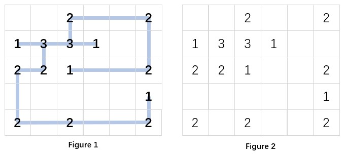

# 题目：
花园设计师画了一张栅栏布局图，如图1所示。这里我们假设花园是一个由单位方格组成的 \(n \times m\) 的矩形空间。图中所有的栅栏都是水平或垂直的，并通过特定指定位置的连接器连接在一起。当工人们把连接器搬到相应位置时，他们发现设计图纸不见了……所以现在你面临着图2中的情况：几个 k 路连接器被放置在了一些位置上。你的工作是恢复图纸，即从图2恢复出图1。


**注意**：栅栏不能弯曲，也不能在没有连接器的情况下相互交叉。拐角只能通过连接器形成。

**输入说明：**
每个输入文件包含一个测试用例。对于每个用例，第一行给出两个正整数：\(n\) 和 \(m\)（\(1 < n, m \le 50\)），分别是花园的行数和列数。
接下来有 \(n\) 行，每行包含 \(m\) 个用空格分隔的数字。每个数字要么是一个正整数 \(k\)（\(1 \le k \le 4\)），表示连接器的度数，要么是 \(0\)，表示该位置没有连接器。

**输出说明：**
对于每个用例，如果无解，只需在一行中输出 `No Solution`。否则，逐行扫描花园（每行从左到右），在一行中输出每个连接器的状态。输出格式如下：

`row col up down left right`

其中 `row` 和 `col` 是连接器位置的行号和列号（行号从上到下从 \(1\) 开始计数，列号从左到右从 \(1\) 开始计数）；\(4\) 个方向 `up`（上）、`down`（下）、`left`（左）和 `right`（右）的状态为 \(1\) 或 \(0\)，分别对应该方向上是否连接了栅栏。
另一方面，解可能不唯一。输出任意一个即可。
一行中的数字必须用空格分隔，且行首和行尾不得有多余空格。

```bash
Sample Input 1:
5 6
0 0 2 0 0 2
1 3 3 1 0 0
2 2 1 0 0 2
0 0 0 0 0 1
2 0 2 0 0 2

Sample Output 1:
1 3 0 1 0 1
1 6 0 1 1 0
2 1 0 0 0 1
2 2 0 1 1 1
2 3 1 0 1 1
2 4 0 0 1 0
3 1 0 1 0 1
3 2 1 0 1 0
3 3 0 0 0 1
3 6 1 0 1 0
4 6 0 1 0 0
5 1 1 0 0 1
5 3 0 0 1 1
5 6 1 0 1 0

Sample Input 2:
5 6
0 0 2 0 0 2
1 3 3 1 0 0
2 2 1 0 0 1
0 0 0 0 0 1
2 0 2 0 0 2

Sample Output 2:
No Solution

Sample Input 3:
3 5
1 1 2 0 1
1 0 3 0 2
1 2 1 0 1

Sample Output 3:
1 1 0 0 0 1
1 2 0 0 1 0
1 3 0 1 0 1
1 5 0 0 1 0
2 1 0 0 0 1
2 3 1 0 1 1
2 5 0 1 1 0
3 1 0 0 0 1
3 2 0 0 1 1
3 3 0 0 1 0
3 5 1 0 0 0
```

# 评分细则
Grading Policy:
Programming: Write the program (10 pts.) with sufficient comments.

Testing: Provide a set of test cases to fill in a test report (3 pts.).  Write analysis and comments (3 pts.).

Documentation: Chapter 1 (1 pt.), Chapter 2 (2 pts.), and finally a complete report (1 point for overall style of documentation).

# 实现与目录

本项目使用 C99 实现栅栏恢复，包含度数约束、空位置交叉互斥，以及自行实现的 CDCL 求解器。正文与伪代码见 [实验报告](documentation/report.md)，定稿见 [PDF 报告](documentation/report.pdf)。

```text
pr3/
├── readme.md                    题面、编译运行及评分映射
├── image.png                    原题布局图
├── code/                        C 程序及独立验证工具
│   ├── README.md
│   ├── main.c
│   ├── fence.c / fence.h
│   ├── sat.c / sat.h
│   ├── Makefile
│   └── tests/                   测试说明与对拍入口
├── documentation/               Markdown、PDF 和实测图表
│   ├── README.md
│   ├── report.md / report.pdf
│   ├── sample_solution.png
│   ├── runtime.png
│   └── assets/                  图表与报告生成工具
└── testresult/
    └── validation-20261020.zip   测试材料及完整逐例结果表
```

新建子目录均提供用途说明；`testresult/` 的材料说明收录于 ZIP 中，遵守该目录仅上传压缩包的规则。

# 编译与运行

在 `pr3` 目录执行：

```bash
gcc -std=c99 -O2 -Wall -Wextra -Wpedantic code/main.c code/fence.c code/sat.c -o fence
./fence < input.txt
./fence --stats < input.txt
python code/tests/run_tests.py --output testresult/run
```

`input.txt` 按题面格式提供单个用例。Windows PowerShell 中可将程序名指定为 `fence.exe`，使用 `Get-Content input.txt | ./fence.exe`。参数 `--stats` 仅将搜索统计写入标准错误，不改变标准输出。合法输入无解时输出 `No Solution`；非法输入以非零状态退出。

程序输出任意合法布局，不以与样例文本逐字相同作为正确性标准。空花园输出为空；布局不要求全图连通。代码接口、变量约定、功能范围见 [code/README.md](code/README.md)。

# 验证与评分映射

1,804 个花园用例、14 个非法输入、2 个接口错误路径和 3,004 个 SAT 核心公式共 4,824 项检查全部通过。测试覆盖题目样例、最小网格、50×50 上界、长边、空位置交叉、四路交汇、奇环、无解、非唯一解及完整小规模穷举。计时和完整逐例表见测试压缩包；报告明确区分实际测量与最坏复杂度分析。

| 题面评分条目 | 分值 | 对应位置 |
| --- | --- | --- |
| Programming：程序与必要注释 | 10 | `code/`，模型与接口说明见 Chapter 2 |
| Testing：测试用例和报告 | 3 | Chapter 3；ZIP 内 `cases.csv`、`sat_results.csv` 及逐例输入输出 |
| Testing：分析与评述 | 3 | Chapter 4 的复杂度推导、实测讨论和适用范围 |
| Documentation：Chapter 1 | 1 | 封面与 Chapter 1 问题描述 |
| Documentation：Chapter 2 | 2 | Chapter 2 数据结构、伪代码与正确性证明 |
| Documentation：完整性和文档风格 | 1 | 全文与 Chapter 5 复现说明 |

报告图表生成工具统一位于 `documentation/assets/`；测试材料 ZIP 不重复包含代码或报告。
